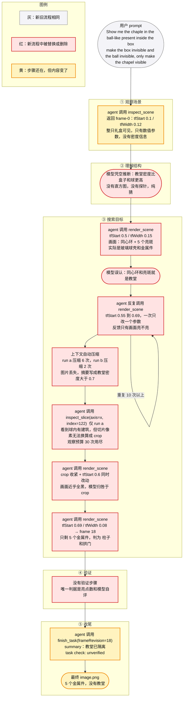
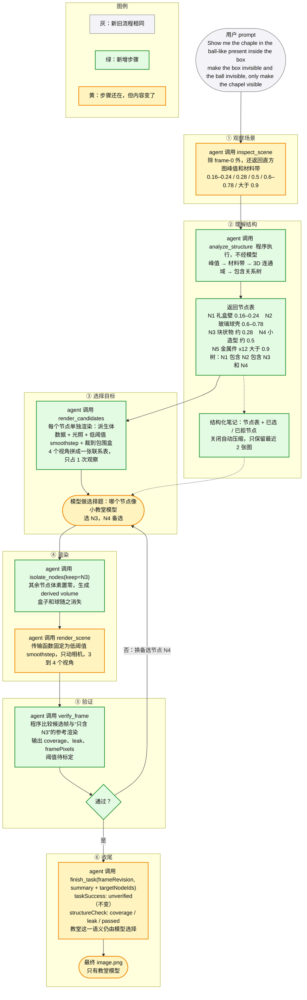

# 03 改动前后流程对比

> 颗粒度是“agent 调用某个工具”。两张图的骨架相同，只有不同的地方才高亮。图中的“新工具”是**提案**，仓库里目前都不存在；详细接口见 `07-worker-implementation-plan.md`。

## 1. 怎么读这两张图

- 灰色：新旧流程里相同的步骤，例如用户 prompt。
- 红色（旧图）：新流程里被替换或删除的步骤。
- 绿色（新图）：新增的步骤。
- 黄色：步骤还在，但内容变了，例如 `inspect_scene` 多返回了直方图，`finish_task` 多了验证指标。
- 旧图按 run b 的轨迹画，只有 `inspect_slice` 那一步来自 run a，已在节点里标注。
- 如果你的环境不渲染 Mermaid，可以把代码块贴到 <https://mermaid.live>。

## 2. 改动前（当前）

## 3. 改动后（提案）

## 4. 差异对照表

| 阶段 | 旧流程 | 新流程 | 解决的根因 |
|---|---|---|---|
| ① 观察场景 | `inspect_scene` 只返回 frame-0 和相机、传输函数、crop 数值 | `inspect_scene` 额外返回直方图峰值和材料带 | R2 信息不对称 |
| ② 理解结构 | 模型凭空推断“教堂比盒子和球密” | `analyze_structure` 由程序建出节点表和包含关系树，不经模型 | R2、R6 |
| ③ 搜索目标 | 反复 `render_scene` 改 `tfStart`，每次只看亮不亮；上下文压缩丢图；切片看到了建筑却无法换算坐标 | `render_candidates` 一次出一张联系表，模型做选择题；节点表写进结构化笔记，不依赖摘要 | R1、R4、R5、R6、R7 |
| ④ 渲染 | 用单调高通传输函数加 crop 在原体数据上硬凑 | `isolate_nodes` 把其他节点体素置零生成派生体数据，`render_scene` 只动相机 | R1、R5 |
| ⑤ 验证 | 没有，只有亮点数和模型自评 | `verify_frame` 用程序比较“只含目标节点”的参考渲染，给出覆盖率、泄漏率和帧像素数；不通过就换备选节点 | R3 |
| ⑥ 收尾 | `finish_task`，`taskSuccess` 为 `unverified` | `finish_task` 增加 `structureCheck` 指标；`taskSuccess` 仍为 `unverified`，语义仍标注为由模型选择 | R3 |

## 5. 不变的部分

这些保持原样，是为了让新旧流程可以在同一套证据体系下做 A/B 对比：

1. Codex CLI 作为 harness，经 MCP 调用渲染服务；所有图像带 sha256，原生状态回读校验照常进行。
2. 观察预算的概念不变，但只有“返回图像”的调用计入预算：`render_scene`、`inspect_slice`、`render_candidates`、`isolate_nodes`。`analyze_structure`、`probe_voxel`、`verify_frame` 不计入预算。
3. `inspect_slice`、`finish_task` 的旧参数保持兼容；新工具只出现在 `toolProfile: v2` 里，旧 profile 的行为与现在逐字节一致。
4. “不给模型语义标签”的原则：节点只带数值（编号、平均密度、体素数、包围盒），不带“教堂”“球”之类的名字。

## 6. 设计取舍说明

- 为什么不继续改传输函数：传输函数是一维的，而“选哪个物体”是空间问题。教堂在密度轴上夹在礼盒壁和球壳之间，球壳又在空间上包着它；用一维窗口加 crop 去逼近，要么泄漏要么截断。体素手术直接在空间上表达“只保留这个物体”。
- 为什么 `analyze_structure` 不经模型：这一步是确定性的几何计算，模型参与只会引入幻觉和延迟；同时它的输出可以被缓存、复现、做单元测试。
- 为什么验证只做到“结构层”：`verify_frame` 能证明“画面里只剩被选中的节点”，证明不了“那个节点就是教堂”。后一半仍由模型的选择和人工真值承担，所以 `finish_task` 的语义字段继续标 `unverified`。
